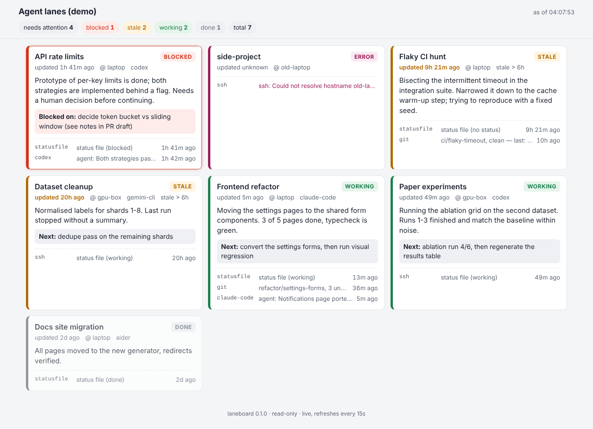
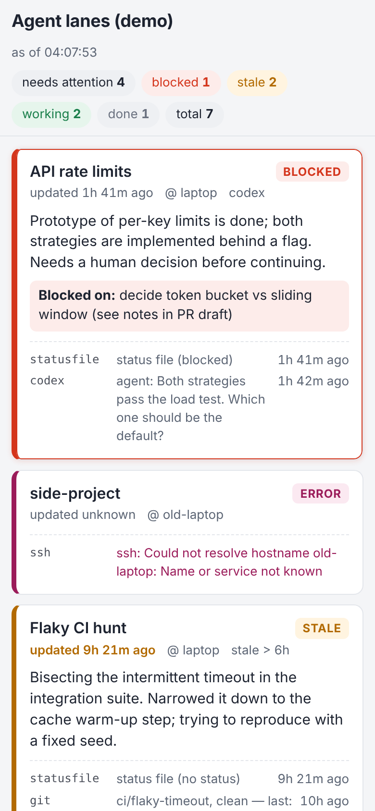

# laneboard

**A read-only status board for all your AI coding agents, across machines and tools.**

You have Codex CLI on a GPU box, Claude Code in two repos on your laptop, Aider in a
third, and a Gemini CLI run that may or may not have finished overnight. laneboard
answers one question, on your phone, in two seconds: *what is each line of work
("lane") doing right now, how long since it moved, and which ones are stuck?*

It does **not** start, stop, prompt or control any agent. It only reads.

| Desktop | Phone |
|---|---|
|  |  |

(Dark-mode versions: [desktop](docs/screenshots/desktop-dark.png), [mobile](docs/screenshots/mobile-dark.png). All data in the screenshots is fictional demo data.)

## Why another agent tool?

Most tools in this space are *orchestrators*: they launch agents, give each one a
worktree, and are tied to one machine and usually one agent CLI. laneboard is the
opposite trade-off.

| | laneboard | claude-squad | vibe-kanban | crystal |
|---|---|---|---|---|
| Starts / controls agents | **no (read-only)** | yes (tmux sessions) | yes (task board launches agents) | yes (desktop app runs sessions) |
| Multiple machines | **yes, via your own `ssh`** | single machine | single machine | single machine |
| Agent tools | **any** (status files) + adapters for Claude Code, Codex, Aider | several CLIs | several CLIs | mainly Claude Code |
| Needs to own the agent process | **no** — zero setup on the agent side beyond (optionally) writing a Markdown file | yes | yes | yes |
| Phone-friendly view | **yes** (one static page) | terminal UI | web UI | desktop app |
| Install | `pipx install laneboard`, stdlib only | Go binary | Node | Electron app |

*Comparison reflects the projects' public descriptions at the time of writing; check
their docs for current features. They are good tools — use them to run agents and
laneboard to watch everything at once. They compose fine.*

## Install

```bash
pipx install laneboard          # Python >= 3.11, no runtime dependencies (not on PyPI yet: use `pipx install .` from a checkout)
pipx inject laneboard pyyaml    # only if you want a YAML config instead of TOML
```

From a checkout: `pip install -e .`

## Quick start

```bash
laneboard init                         # writes ./laneboard.toml with commented examples
$EDITOR laneboard.toml
laneboard status                       # terminal table
laneboard tui                          # same, redrawn every refresh_seconds
laneboard serve                        # http://127.0.0.1:8765, auto-refreshing
laneboard snapshot --html board.html   # one self-contained HTML file
laneboard notify                       # check once and push alerts (for cron)
```

Try the demo (all fake, all local — including a stand-in `ssh`):

```bash
python examples/demo/make_demo.py /tmp/laneboard-demo
laneboard -c /tmp/laneboard-demo/laneboard.toml serve
```

## The status-file convention

The simplest and most portable source is a Markdown file per lane. Ask your agent
(e.g. in `AGENTS.md` / `CLAUDE.md`) to keep it updated, or update it yourself:

```markdown
---
status: blocked            # working | blocked | done   (anything else is shown as-is)
updated: 2026-05-01T14:30:00Z
owner: codex               # who/what is working on it (free text)
next: decide token bucket vs sliding window
---
# API rate limits

Prototype of per-key limits is done; both strategies are behind a flag.
Needs a human decision before continuing.
```

Specification:

* The front-matter block is optional. It must start on the first line with `---`
  and end with `---` (or `...`). Only flat `key: value` lines are read (a tiny,
  safe YAML subset; indented continuation lines are joined). Unknown keys are ignored.
* Fields (all optional):
  * `status` — `working`, `blocked`, `done`. Aliases: `wip/active/running/in-progress` →
    working, `stuck/waiting/needs-input` → blocked, `finished/complete/merged` → done.
    Other values are displayed verbatim.
  * `updated` — ISO 8601 (`2026-05-01`, `2026-05-01 14:30`, `2026-05-01T14:30:00+02:00`)
    or Unix seconds. Naive times are local time. **If missing, the file's mtime is used.**
  * `owner` — free text (agent name, machine, person).
  * `next` — the next step, or what the lane is blocked on.
  * `title` — display name; defaults to the first `# Heading`, then the file name.
  * `lane` — lane key; defaults to the file name without `.md`.
  * `summary` — overrides the summary below.
* Summary: the first prose paragraph of the body (headings and code blocks skipped,
  list markers stripped, cut at 280 characters).
* A file with no front-matter at all still works: mtime + first heading + first paragraph.
* `README.md` in a lanes directory is skipped.

### Lanes merge by name

Every source produces lanes keyed by name (case-insensitive). A status file
`frontend-refactor.md`, a git repo directory `frontend-refactor/` and a Claude Code
session whose working directory is `.../frontend-refactor` become **one card**
with three "signals". The newest timestamp of all signals counts as the lane's
`updated`, so an agent that is actively writing logs keeps its lane fresh even if
nobody touched the status file.

## Rules

* **stale**: no signal newer than `stale_hours` (global, or per source). `done` lanes never go stale; lanes with no timestamp at all are shown as `unknown`, not stale.
* **blocked**: `status: blocked` — always sorted first and highlighted.
* **error**: a source failed (ssh unreachable, path missing...) and nothing else is known about the lane.
* Order: blocked, error, stale, working, other, done; newest first inside each group.

## Configuration

`laneboard` looks for `--config FILE`, then `$LANEBOARD_CONFIG`, then
`./laneboard.toml|yaml`, then `~/.config/laneboard/config.toml|yaml`.

```toml
[board]
title = "My agents"
stale_hours = 6
refresh_seconds = 30
# host = "127.0.0.1"
# port = 8765
# state_file = "~/.local/state/laneboard/notify-state.json"

[[source]]                       # local status files
type = "local"
name = "laptop"
path = "~/projects/lanes"        # or paths = [...]; a single file also works
pattern = "*.md"

[[source]]                       # status files on another machine
type = "ssh"
host = "gpu-box"                 # an alias from YOUR ~/.ssh/config
paths = ["~/work/lanes/*.md"]    # glob allowed in the file name
timeout = 10
stale_hours = 12                 # per-source override
# ssh_command = ["ssh"]          # override the binary (e.g. a wrapper)
# ssh_options = ["-o", "ControlMaster=auto"]
# remote_mtime = true            # also read file mtimes with `stat`

[[source]]                       # git repos
type = "git"
paths = ["~/projects/frontend-refactor", { path = "~/projects/exp", lane = "paper-experiments" }]

[[source]]                       # EXPERIMENTAL agent log adapters
type = "claude-code"             # default path ~/.claude/projects
max_age_days = 3
max_sessions = 20
[[source]]
type = "codex"                   # default path ~/.codex/sessions
[[source]]
type = "aider"
paths = ["~/projects/docs-site"]

[[notify]]
type = "ntfy"
url_env = "LANEBOARD_NTFY_URL"   # e.g. https://ntfy.sh/<long-random-topic>; or url = "..."
on = ["blocked", "stale"]

[[notify]]
type = "webhook"                 # POSTs JSON: {event, lane, title, message, state, previous_state, data}
url_env = "LANEBOARD_WEBHOOK_URL"
headers_env = { Authorization = "LANEBOARD_WEBHOOK_AUTH" }
```

The YAML form is the same structure (`board:`, `sources:` list, `notify:` list).

### Sources in detail

* **local** — reads `*.md` (configurable `pattern`) in a directory. Files are read up to 256 KiB.
* **ssh** — runs `ssh -o BatchMode=yes -o ConnectTimeout=N <host> '<snippet>'` where the snippet
  is a POSIX `sh` loop that `stat`s and `head -c 256K`s each matching file. Paths are
  shell-quoted; glob patterns may only contain `[A-Za-z0-9._*?-[]]`. `~/` is expanded on the remote side.
  One ssh call per configured path; sources run in parallel.
* **git** — `git rev-parse --abbrev-ref HEAD`, `git log -1`, `git status --porcelain`, all with
  `--no-optional-locks` so the index is never rewritten. Shows branch, uncommitted file
  count, last commit subject and time.
* **claude-code / codex / aider** (*experimental*, see below).

### Agent log adapters (experimental)

These read the agents' own local logs. Their formats are undocumented internals and may
change at any time; the adapters are defensive (unknown lines are skipped, worst case you
get "last activity = file mtime") but treat them as best-effort.

| Adapter | Where | What is read |
|---|---|---|
| `claude-code` | `~/.claude/projects/<encoded-cwd>/<session>.jsonl` | `cwd` → lane name, newest `timestamp`, last user/assistant text block (thinking and tool output are ignored) |
| `codex` | `~/.codex/sessions/YYYY/MM/DD/rollout-*.jsonl` | `session_meta.cwd` (or `<cwd>` in the environment context) → lane name, newest `timestamp`, last `output_text`/`agent_message`. Both the wrapped (`{timestamp,type,payload}`) and older unwrapped line formats are handled. |
| `aider` | `<repo>/.aider.chat.history.md` | file mtime, last `#### ` user line |

Only the last 512 KiB of each log is read, and only a 160-character snippet of the last
message is kept. These adapters only read logs on the machine where laneboard runs.
For an agent on another machine, let it (or a small cron job there) write a status file
and read that over ssh.

Writing your own adapter: subclass `laneboard.sources.agents.SessionAdapter`
(`session_files(root)` and `parse(path) -> SessionInfo`) and call `register_adapter()`,
or ship any `(spec: dict) -> list[Lane]` function under the `laneboard.sources`
entry-point group:

```toml
# your package's pyproject.toml
[project.entry-points."laneboard.sources"]
gemini-cli = "my_pkg.laneboard_gemini:collect"
```

## Notifications

When a lane **enters** `blocked` or `stale` (or a lane is first seen in that state),
laneboard sends one push per target. It remembers the last state per lane in a small
JSON state file, so restarts don't re-alert; a failed push is retried on the next round.
`serve` checks every `max(60s, refresh_seconds)`; without `serve`, run `laneboard notify`
from cron or a systemd timer. Use `laneboard serve --no-notify` to disable.

## Security

* **Read-only by design.** No source writes anything. The web server answers `GET`/`HEAD` only; anything else is `405`.
* **No credentials in laneboard.** Remote access goes through your own `ssh` binary with
  `BatchMode=yes` (it never prompts and never sees a password); keys, agents, jump hosts
  all stay in your `~/.ssh/config`. Notification URLs/tokens can be read from environment
  variables (`url_env`, `headers_env`) so they stay out of the config file.
* **Injection-safe remote commands.** Paths are shell-quoted; host names starting with
  `-` or containing shell characters are rejected.
* **Localhost by default.** `serve` binds `127.0.0.1` and has **no authentication**. Lane
  summaries and agent message snippets can contain sensitive project details. To look at
  it from your phone, prefer an SSH tunnel (`ssh -L 8765:127.0.0.1:8765 host`) or a private
  VPN/tailnet; if you bind to another address laneboard prints a warning.
  Don't expose it to the public internet. If you must, put it behind a reverse proxy with
  authentication.
* **Strict page.** Responses carry a nonce-based `Content-Security-Policy`
  (`default-src 'none'`), `X-Frame-Options: DENY`, `no-referrer`, `nosniff`. All text is
  HTML-escaped. No external fonts, scripts or CDNs.
* **Snapshots are plain files** containing the same summaries: store them somewhere private.
* Status files are parsed with a small built-in front-matter parser, not a YAML loader, so
  a status file can't trigger object construction.

## Limitations

* No authentication or multi-user features in `serve` (by design: put it behind something that has them).
* Remote agent *logs* are not read over ssh (only status files). Run laneboard on that machine, or use status files.
* Remote status files without an `updated:` field need `stat` on the remote (GNU or BSD); otherwise their time is unknown.
* One ssh connection per configured path per refresh. With many hosts, enable ssh `ControlMaster` in your ssh config or raise `refresh_seconds`.
* Agent log adapters are experimental (see above); Gemini CLI and others are not built in yet.
* Staleness is time-based only; a looping agent that keeps writing logs looks "fresh".
* POSIX-oriented (Linux/macOS). Windows is untested.

## 中文说明

laneboard 是一个**只读**的 AI 编码代理状态看板：把分散在多台机器、多种工具（Codex CLI、
Claude Code、Aider、Gemini CLI……）上的每一条"工作线"（lane）汇总到一页，手机上一眼看清
"现在在做什么、多久没动了、卡在哪"。

* **不启动、不控制任何代理**，零侵入。与 claude-squad、vibe-kanban、crystal 等"启动/管理代理"
  的工具互补，而不是替代。
* **数据源**：本地 Markdown 状态文件（可选 front-matter：`status`/`updated`/`owner`/`next`，
  没有 front-matter 时用文件修改时间和首段摘要）；通过你本机的 `ssh`（使用你自己的
  `~/.ssh/config`，工具不保存任何密钥）读取远程状态文件；git 仓库（分支、未提交改动数、
  最近提交时间）；实验性的 Claude Code / Codex / Aider 本地日志适配器。
* **规则**：超过 `stale_hours` 没更新标记为 stale；`status: blocked` 置顶高亮；变成 blocked
  或 stale 时可通过 ntfy 或通用 webhook 推送（只在状态变化时推一次）。
* **输出**：`laneboard serve`（默认只监听 127.0.0.1，自动刷新，适配手机）、
  `laneboard snapshot --html out.html`（单个自包含 HTML）、`laneboard status` / `tui`（终端表格）。
* **安全**：服务没有鉴权，请勿暴露到公网；手机查看建议用 SSH 隧道或私有 VPN。
* **局限**：日志适配器依赖各工具未公开的内部格式，可能随版本变化；远程机器只读取状态文件，
  不读取远程代理日志。

## License

MIT, see [LICENSE](LICENSE). Contributions welcome — see [CONTRIBUTING.md](CONTRIBUTING.md).
Running it permanently on your own machine: see [DEPLOY.md](DEPLOY.md).
